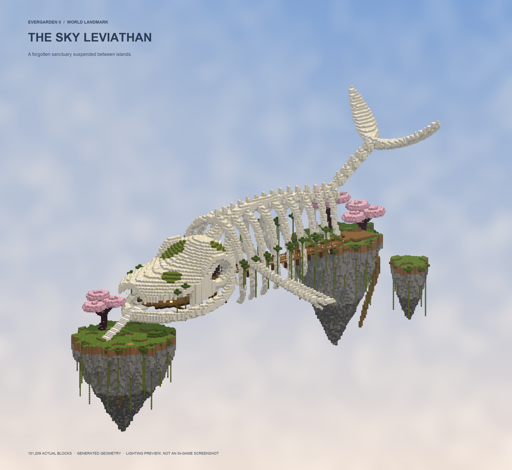

# Evergarden2 — Sky Landmarks

Evergarden **3.0.0-e2.156-malefeasance-v5** redraws both Malefeasance forms as anime sorceresses (no code changes):
- **Phase 1:** a beautiful, wicked witch in the style of Merlin, with long black hair, a tall wine-lined collar, a crescent staff, a grimoire and a violet orb.
- **Phase 2:** a cute, smug little witch with a big curled hat, lilac twin tails, starry eyes with a fang grin, bat wings and a star wand.

It is built on e2.154 (pets) and e2.153 (boss balance) and uses Bedrock pack **3.62.0**. Install it with Advance Magic 1.34.1. See [Malefeasance v5](docs/malefeasance-v5.md) and the previews: [phase 1](previews/malefeasance-v5/phase1-before-after.png), [phase 2](previews/malefeasance-v5/phase2-before-after.png).

Evergarden **3.0.0-e2.154-pet-grounding** makes grounded pets fall when their floor is
removed, lets right-clicks target the visible sculpture, gives Bedrock pets a touch
volume, and shows the remaining feeding cooldown. It preserves e2.153 boss balance,
every resource pack and the latest embedded mirror list. See [pet grounding and clicks](docs/pet-grounding-and-clicks.md).

Evergarden **3.0.0-e2.153-boss-balance** changes:
- **Malefeasance:** both forms are re-sculpted (Bedrock pack **3.61.0**). Blinks now come after a 0.8 s warning and every 7.5 s (previously 0.3 s and 2.1 s).
- **Arkhaia:** ritual spirits have 50% HP and deal 75% damage.
- **Vault temples:** they no longer pull players back to the floor, so jumps, wind charges and maces work. Players on pillars, under the floor or outside the ring can't hit the encounter. The temple resets after 15 s with nobody inside, and escaped mobs still return to the centre.

Install it with Advance Magic 1.34.1. See [boss balance](docs/boss-balance.md) and the [new model preview](previews/malefeasance-v4/after.png).

Advance Magic **1.34.1-bedrock-pack-repair** fixes the Bedrock pack (29.2 MB → 6.3 MB, pack 2.35.0).
A stale rebuild at 15:24 on 2026-10-26 had shipped in 1.33.0–1.34.0:
- it brought back effects retired in 1.29.0 and dropped the judgment_gold particles;
- it restored the flying staff tier 2 model from before 1.32.0;
- it skipped palette compression on 300+ textures;
- its pack version went backwards (2.33.1 after 2.34.0).

1.34.1 is the 2.34.0 pack plus that build's legendary-block/mushroom files. Everything else is unchanged.
Install it with Evergarden e2.152.

Advance Magic **1.34.0-pack-embedded** and Evergarden **3.0.0-e2.152-pack-embedded**
send all three Java packs in one request, keep the Judge pack's hash across restarts, and
recover a broken batch pack by pack instead of kicking. Each JAR embeds the fingerprints and
SHA-1s of the packs published on raw.githubusercontent.com, so servers offer those copies at once,
even without outbound HTTPS; the game port stays the fallback. Evergarden e2.152 includes
e2.151-dungeon-balance. Install both JARs together; see [pack mirror](docs/pack-mirror.md).

Evergarden **3.0.0-e2.148-seraph-celestial** redesigns the Seraph trader at the
Evergarden spawn: a slender figure in a floor-length gown, a smaller face framed by
long silver hair, painted three-layer feather wings and a thin golden halo. Only the
Seraph model and Bedrock pack **3.60.0** change; the shop and saved data are untouched.
See [Seraph trader](docs/seraph-trader.md) and the [before/after preview](previews/seraph-celestial/before-after.png).

Advance Magic **1.31.1-max-gems** and Evergarden **3.0.0-e2.143-max-gems** add
Max Gems to the same two `/spell` sockets: +250 cast capacity each, or 300 → 800
with two. Mix with Damage/Cooldown Gems or use duplicates. Inserting a Max Gem
preserves remaining casts; removing it clamps to the new cap, preventing free
repairs from swaps. Both JARs preserve the latest worldgen and prior Gem/Vault
changes. See [Gem use and release details](docs/staff-gems.md).

Advance Magic **1.31.0-staff-gems** and Evergarden **3.0.0-e2.141-staff-gems**
add two removable Gem sockets to `/spell`. Damage Gems give +15% spell damage;
Cooldown Gems give −15% cooldown. Duplicate Gems add to 30%, or mix them for
15% of each. Staffs use these sockets instead of permanent +10 Core ranks.
Install both JARs together; the combined release preserves spell levels, scroll
fusion, map/pickaxe fixes and the updated Vault balance. See [Gem use and release details](docs/staff-gems.md).

Evergarden **3.0.0-e2.139-vault-balance** adds native enchant books to Tier 1–2
Vaults (35% / 45%), with Sharpness, Protection and Efficiency VI–VII plus Looting,
Fortune and Unbreaking IV–V. Tier 1 awards the lower level; Tier 2 books have a
30% upper-level chance. Tier 2 Rare weapons and elemental staffs each have a
0.25% independent bonus chance; Tier 3–5 retain 5/10/15% weapon chances and gain
10/15/20% elemental staff chances. Books use the existing high-level anvil transfer.
See [Vault rewards and anvil compatibility](docs/vault-balance.md).

Evergarden **3.0.0-e2.125-boss-core-textures** adds dedicated hand-painted
Seraph and Revenant core textures for Java and Bedrock **3.52.0**. Both armor
sets are exchanged inside Seraph's existing **ร้านตำนาน**, without a separate
armor category. Previously earned cores migrate to the new visuals and remain
spendable. See [core artwork](evergarden/art/boss-armor-cores/preview.html).

Evergarden **3.0.0-e2.124-boss-armor-exchange** adds one Core of Seraph per
Seraphon defeat and one Core of Revenant per final Arkhaia defeat. Seraph's
**ร้านตำนาน** shop exchanges one matching core for any chosen piece of
that set, with no extra materials or shop limits. The boss at boss-temple is
deferred. See [boss armor exchange](docs/boss-armor-exchange.md).

Advance Magic **1.23.0-armor-combat** and Evergarden **3.0.0-e2.123-armor-combat**
add Revenant death guards, full-set lifesteal and six unique Sanctuary HP rewards;
full Seraph separates undead x4 from other damage x2 and repels undead pursuit.
Both sets have native breakable durability and 150% netherite armor/toughness,
minimal `Combat` base lore, and retain existing enchants/upgrades.
Install both JARs together; see [armor combat rules](docs/armor-combat.md).

Evergarden **3.0.0-e2.122-seraphon-heavens-verdict** adds Seraphon as the
10,000-HP guardian of Supreme Sanctuary: three phases, six-wing feather fans,
golden casting gates, solar pillars, rotating beams and Heaven's Verdict with
cyan safe petals. Archived golden spell-circle vectors power the new effects;
the existing model and authored animations are preserved.
See [encounter and installation](docs/seraphon-heavens-verdict.md) and the
[offline animated effect review](previews/seraphon-encounter/index.html).

Evergarden **3.0.0-e2.121-boss-hitbox-fix** aligns boss melee targets with their
visible size, transformed body and animation clock, makes Banshee's lower gown
targetable, and preserves swing-time aim for native fallback attacks. Boss models
and embedded resource packs are byte-identical to the previous release.
See [hitbox changes and installation](docs/boss-hitbox-fix.md).

Evergarden **3.0.0-e2.120-airborne-boss-combat** keeps Wind Charge users in active
Overworld sanctuary fights, preserves committed attacks, adds warned aerial
responses for Acheron and Styx, and fixes elevated ranged targeting and beam
boundaries. See [mechanics, validation and installation](docs/airborne-boss-combat.md).

Advance Magic **1.20.1-controller-flight** fixes flying-staff strafing, restores
Bedrock controller analog speed, adds smooth camera height control, and makes
nearby boarding available through item use. Repeated use no longer spends extra
durability or rapidly toggles Turbo; held utility staffs and rider head clearance
are fixed. See [controls, validation and installation](docs/flying-staff-controller-fix.md).

Evergarden **3.0.0-e2.101-boss-rewards** and Advance Magic
**1.20.0-boss-exploration-points** add six colored sanctuary Soul Orbs and direct
Skill Tree points from boss victories and first-open structure treasure.
Ordinary mobs and scroll discovery no longer grant progression; existing ranks
and points are preserved. Defeated sanctuary bosses leave the arena empty for
24,000 game ticks. Java and Bedrock artwork is bundled in pack **3.38.0**.
See [reward rules, artwork and respawn timing](docs/boss-orbs-and-skill-points.md).

Advance Magic **1.19.1-retired-recipe-cleanup** migrates the eight retired
elemental staff recipe-book entries before player data loads, preventing
unrecognized-recipe startup errors. Original player files are backed up in
`plugins/advance-magic/retired-recipe-backups/`.

Advance Magic **1.19.0-amethystwood-affinity** adds a craftable neutral wooden
starter staff (one spell, upgradeable to two; maximum Rare), cross-element
imprinting with 150% matching or 50% mismatched damage, and confirmed extraction
back into a scroll. New native Java/Bedrock wooden staff models are bundled in
pack **2.18.0**. See [crafting, affinity and extraction](docs/amethystwood-and-affinity.md).

Advance Magic **1.18.0-native-spell-vfx** gives the 58 elemental spells native
Minecraft effects: Blaze fireballs, descending Ghast fireballs, animated water,
wind, lightning and vanilla block fragments. The new default replaces illustrated
spell planes with moving volumes and physical silhouettes. See
[native spell effects and settings](docs/native-spell-vfx.md).

Advance Magic **1.17.0-loot-only-staffs** and Evergarden
**3.0.0-e2.97-elemental-staff-loot** make the eight elemental staffs loot-only:
10% per Vault reward, 3% per new Whale / Observatory / Hanging Garden chest,
and 1% per new Evergarden structure chest in the Overworld. Staff elements are
equally likely; each drop starts with three empty spell slots. Crafting recipes
are removed and blocked. See [drop rules and installation](docs/elemental-staff-loot.md).

Advance Magic **1.16.0-rare-spell-vfx** upgrades all 10 Ultimate spells and 15 Epic
spells with layered hero artwork, elemental accents, impact shapes and stronger
animation timing. Java and Bedrock packs are embedded in the JAR; Bedrock pack
version is **2.17.0**. Damage, mana, cooldowns and hit timing are preserved.
See [installation and validation](docs/elemental-vfx-release.md).

Advance Magic **1.13.0-elemental-spell-system** adds 58 elemental spells, permanent
scroll imprinting into 3/4/5-slot staffs, per-player cooldowns, reactions and a
shared Java/Bedrock inventory UI. `/skilltree` opens the new permanent player
specialization tree. Evergarden **3.0.0-e2.95-elemental-scroll-treasure** adds spell
scroll rolls to newly authored structure chests. Install both plugin JARs.
See [controls, survival recipes, loot, skill progression and limitations](docs/elemental-spell-system.md).

Advance Magic **1.12.1-bedrock-staff-vfx** replaces Bedrock's obstructive staff
effect sheets with small crown-local 3D glints and excludes Bedrock viewers from
near-camera server dust. The approved Java pack and existing Evergarden JAR stay
unchanged. Update only Advance Magic and reconnect for Bedrock pack **2.15.1**.
See the [Bedrock effects hotfix](docs/bedrock-staff-vfx.md).

Advance Magic **1.12.0-elemental-staff-models** and Evergarden
**3.0.0-e2.94-elemental-staff-models** replace the offensive wand catalog with
eight elemental staff models: Fire, Wind, Earth, Ice, Water, Lightning, Light
and Dark. Native Java/Bedrock 3D models, animated VFX, hand poses and editable
ModelEngine R4.1.1 sources are included. Legacy wands migrate with their data
preserved; old crafting/player casting is retired while skill loadouts are being
redesigned. Legendary/shared artwork, existing core entitlements and separate
legendary weapons/utility staffs remain. See the [staff models and migration](docs/elemental-staffs.md)
and [asset gallery](previews/elemental-staffs/index.html).

Evergarden **3.0.0-e2.93-sanctuary-encounters** adds passive resident bosses to all
six Overworld sanctuaries. Strike a boss inside its marked arena to begin.
Cocytus gains ice lanes and a cover-based blizzard, Malefeasance gains bound
shadows and an interruptible sacrifice, and Styx gains axe combos, a punishable
dash and stance breaks. Arena boundaries, projectile origins, ordinary mob
spawning and terrain/vehicle exploits are enforced. Existing combat floors are
repaired selectively; the resource pack is now **3.34.0**.
See [encounter mechanics, protection and release details](docs/sanctuary-encounters.md).

Evergarden **3.0.0-e2.80-sanctuary-habitat** clears stray tree crowns, limits natural
hostile spawning to areas outside the six authored sanctuary footprints, replaces
armor-trim treasure rolls with real mana potions and adds three protected armored
guard spawners per site. Native spawner events remain eligible for LevelledMobs.
See [habitat, treasure, guard limits and migration details](docs/overworld-sanctuaries-habitat.md).

The preceding 3.0.0-e2.79-sanctuary-structural-polish corrects the six Overworld
landmarks after a visual and connectivity audit. Styx has a connected crescent axe,
forged socket and grounded gate terrace. Rose windows, roof gantries, the turquoise
dome, lantern turret, stair stringers and ceiling hangers now join their buildings.
Tables, cabinet tops and inward-facing mosaics have corrected proportions. Fence
and wall joins are explicitly authored and checked in real Paper chunks. All six
assets have zero detached assemblies in the structural audit; 110 furnished spaces,
48 treasure caches, rare-material budgets and boss arenas remain. Existing v1-v4
worlds upgrade selectively without refilling treasure or replacing player edits.
See the [multi-angle gallery](previews/overworld-sanctuaries-v5-final/index.html),
[axe inspection](previews/overworld-sanctuaries-v5-final/styx-axe.png), and
[corrections and upgrade details](docs/overworld-sanctuaries-v5.md).

Evergarden `3.0.0-e2.58-exploration-redesign` rebuilds all twenty medium destinations
with fewer large houses and more distinct outdoor locations, compact workrooms,
open quarries, caravan wagons, ruined estates, root grottoes and canopy decks.
Interiors include usable kitchens, desks, machinery, sleeping areas and storage.
Every cache and occupied workstation is reachable from the entrance on foot.
Medium destinations keep 5–6 chests and 50% more ordinary supplies; equipment,
enchantments and rare-drop odds retain the previous loot table.
Existing terrain and spawn decisions stay the same. Explored e2.54–e2.57 structures,
inventories, player edits and unfinished fragments retain their original geometry.
See [all destinations, loot quantities and upgrade behavior](docs/living-biomes.md).
Browse the [gallery with exteriors, interiors and the previous designs](previews/exploration-redesign/index.html).
See the [twenty redesigned structure previews](previews/exploration-redesign/overview.png).
See the [small structures with doors](previews/medium-destinations/small/overview.png).
See the [production spawn-rate survey](docs/exploration-rarity.md).
See the [four updated biome scenes](previews/living-biomes/scenery/biome-scenery-contact-sheet.png).

Evergarden `3.0.0-e2.53-continental-biomes` adds four continental skyland biomes:
glacial massifs, ancient forests with giant trees, the lost lunar city and Evergarden
gardens. Regions use a 3,072-block default scale with curved borders, blended terrain
and long sky fissures. Existing structures keep their coordinates and rewards;
fresh terrain fits beneath them as either floating clearances or attached foundations.
Existing region files retain the original generator with gradual transitions outside.
See [biomes, upgrade behavior and exploration commands](docs/continental-biomes.md).
See the [16 km terrain map](previews/biome-world/overview-terrain-map.png) and
[actual-block scenery samples](previews/biome-world/scenery/biome-scenery-contact-sheet.png).

Evergarden `3.0.0-e2.51-boss-enchant-transfer-and-effects` furnishes the approved Arkhaia,
Valkyrie and Seraphon architecture with throne halls, blade altars, chandeliers,
mosaics, protected armor displays and eight decorated treasure chests per structure.
The configurable loot includes 29 equipment profiles, Sharpness VI–VIII,
Fortune IV–V and Protection VI–VIII. Existing e2.49 structures receive furnishings
as their chunks load, preserving exterior geometry, original inventories and edits.
Boss enchant levels now transfer through anvils without being reduced or growing
from equal-level merges. Runtime extensions handle Protection/Feather Falling,
Depth Strider and Swift Sneak saturation while ordinary enchanting stays capped.
See [all 31 enchant mechanics and exploit checks](docs/boss-enchant-mechanics.md).
See [interiors, loot and upgrade behavior](docs/boss-interiors-and-treasure.md),
[interior cutaways](previews/boss-interiors/overview.png),
[phase-one structures and admin commands](docs/boss-structures-phase-one.md)
and [exterior previews](previews/boss-structures-v2/overview.png).

Advance Magic `1.8.3-quiet-mana-clean-wands` adds native Amethyst mana brewing:
Water Bottle + Nether Wart → Awkward Potion + Amethyst Shard → an independently
rolled mana potion in each of the three bottle slots. Quality rates are 60/30/8/2 percent. Four qualities restore
20/35/50/100 mana; permanent mana growth caps at 200 and costs temporary maximum
health until deep sleep. See [recipe, balance and recovery](docs/mana-potions.md).

Retired Key Shards, Repair Stones and Void Elixirs have been removed from recipes, loot, admin menus and resource packs. Legacy stacks are cleaned on login and chunk/inventory access, including Shulker Boxes and Bundles. See [cleanup and smaller packs](docs/retired-relic-cleanup.md).

All 21 spell wands cast their main spell directly on use, whether standing or sneaking. Mana costs, cooldowns, durability and mastery still apply. Legendary equipment keeps its separate sneak skills; flying staff controls are unchanged.

ซากวาฬลอยฟ้าออกแบบใหม่: กะโหลกเปิดเป็นห้องพัก กระดูกขากรรไกรโค้ง ซี่โครงที่ค่อย ๆ เรียวและมีรอยหัก กระดูกสันหลังยกไปสู่หางรูปพระจันทร์เสี้ยว ทางเดินไม้ ตะเกียง มอส และสวนเชอร์รีบนเกาะลอย

This repository is the isolated Evergarden / Advance Magic experiment. The plugin names remain compatible with the original modules. The default test world is `evergarden`. Evergarden build `3.0.0-e2.3` places the redesigned landmark rarely across that world. Each site's main route is at Y 100–124.

Advance Magic `1.6.3-celestial-cinematic-polish` and Evergarden `3.0.0-e2.39-celestial-cinematic-polish`
add Verdant Sovereign, Lunar Requiem and Crimson Oblivion: original wand/core textures,
layered dragon engravings with a forward beam and traveling energy waves,
sixteen lunar portals with rotating halos, thin rays and a constellation altar,
eight separate Crimson shard impacts with expanding shockwaves, and matching recipes
and Vault cores. Install both updated JARs in `dist/` and reconnect to load their
bundled Java/Bedrock packs. See the [legendary wand guide and artwork](docs/legendary-wands.md).

Evergarden `3.0.0-e2.34-wand-security` fixes Survival wand duplication when applying
scrolls and moving/dropping equipment before the next tick. Scroll and repair
crafting now delivers output exactly once and preserves inputs when the cursor
cannot receive it. Install the updated `dist/evergarden.jar` and restart; replacing
Advance Magic alone does not fix this cross-plugin path. See the
[wand duplication audit and regression checks](docs/wand-security-audit.md).

Evergarden `3.0.0-e2.33-vault-security` preserves Vault claims when temple cooldowns
are reset, removes the sneaking admin/Creative repeat-opening bypass, and stops
reward delivery when claim storage fails. New claims record the player UUID and
selected loot. See the [Vault audit and production update notes](docs/vault-security.md).

## Two additional sky landmarks (3.0.0-e2.4)

The celestial observatory follows the reference's open blue/purple ribbed dome,
large oxidized-copper and gold telescope, columned terraces, cherry gardens and
waterfalls. The hanging garden has an inverted stone island, teal-roofed pavilion,
cyan crystal roots, hanging foliage and a continuous spiral staircase from its
lower arrival island to the summit. Both are ordinary vanilla blocks.

[Observatory block preview](previews/observatory-block-preview.png) ·
[Hanging garden block preview](previews/hanging-garden-block-preview.png)

These previews render the actual generated block positions with simulated lighting;
they are not Minecraft screenshots. The observatory contains 379,671 blocks and the
hanging garden 220,587. Block geometry is cached once and clipped to each chunk.

Install the updated root `dist/evergarden.jar` and restart. Existing generated
chunks are preserved; the new landmarks appear in **fresh chunks**. Admin commands:

```text
/evergarden tp observatory
/evergarden tp garden
```

`structures.observatory.enabled` and `structures.hanging-garden.enabled` toggle
the two types separately. They share the world's saved whale spacing/chance and
accepted grid cells. Each eligible cell searches for a non-overlapping pair around
the unchanged whale position. Crowded cells that cannot fit both skip the pair.
In three 289-cell tests, counts were exactly equal across all three types:
89/89/89 for seed 72819345, 68/68/68 for 12345, and 89/89/89 for -817342.
The new geometry also avoids the existing sanctums and spawn area.

All three landmarks use **`structures.treasure`**: one chest, a 30% chance of a
second and the original bonus weights by default. Every chest
always contains one randomly chosen repair/damage/cooldown core. Changing the
shared settings affects newly generated chests, never refills previously claimed
chests. The one-time marker survives chest removal and server restarts.

The disposable Paper test checks the generated blocks, clear route headroom,
stair directions, persistent leaves, shared loot settings, and chest removal plus
player edits across a real server restart:

```text
python tests/sky-landmarks/run.py --paper-template /path/to/paper-template --paper-jar paper.jar --java-home /path/to/jdk25
```

`evergarden/tests/SkyLandmarkChecks.java` checks reachable treasure, bounds,
determinism, placement rates and exclusions without a server; supplying an output
directory exports the exact blueprints as CSV. Render them with
`tools/preview_landmarks.py <exports> --minecraft-jar <client.jar>` (NumPy/Pillow).

## Actual block previews



[Skull sanctuary close-up](previews/sky-whale-sanctuary-detail.png) · [Complete side view](previews/sky-whale-side-preview.png)

These are renders of the **101,209 block positions** in `SkyWhale.blocks()`, including the floating islands. Vanilla textures are read from a locally installed Minecraft client; lighting and sky are simulated. These images are not Minecraft client screenshots. The renderer adds no foreground structures. The shape is also verified against chunks generated by Paper.

## Build and try

Evergarden `3.0.0-e2.41-existing-structure-protection` protects sky whales,
observatories and hanging gardens, and recovers existing landmarks missed by
historical placement changes. Ordinary terrain remains mineable. Replace
`dist/evergarden.jar` and restart; no world regeneration is needed. Players can
inspect a block with `/evergarden protection` without OP. See the
[structure protection rules and regression checks](docs/structure-protection.md).

Requires Java 25+, Maven and Python 3. Run `./build.sh` or `mvn -pl afterdeath,advance-magic,evergarden -am clean package -DskipTests`. This produces `afterdeath/target/afterdeath.jar`, `advance-magic/target/advance-magic.jar`, and `evergarden/target/evergarden.jar`. `./build.sh` checks every JAR for compiler error stubs before copying them to `dist/`, without copying files to a server. For a manual Maven build, run `python tools/release_jar_checks.py afterdeath/target/afterdeath.jar advance-magic/target/advance-magic.jar evergarden/target/evergarden.jar` before publishing. Seven Sins is paused and excluded from the default build; its existing source and JAR remain available.

`7sins` includes Wrath, the Ashen Executioner: an original articulated model, an embedded Java resource pack, and a two-phase boss with telegraphed attacks. Summon it with `/7sins spawn wrath` (operator). Bedrock and players without the pack receive a vanilla armor fallback. See [7sins setup and combat guide](7sins/README.md).

## AfterDeath

`dist/afterdeath.jar` adds the AfterDeath plugin from the Afterdeath repository. A death clock is awarded only for a death that drops items and was not caused by another player; this avoids awarding one for PvP deaths and keep-inventory deaths. The clock goes into an available inventory slot, and a full inventory is left unchanged. The clock lasts 120 seconds; select it and right-click to return to the death location. Operators can test with `/deathclock`. `/platform` identifies Java or Bedrock players; Bedrock detection requires Floodgate, which remains optional.

Install on a separate test server. These JARs use the existing plugin names, so use one version of each plugin per server. An administrator can jump to the approach island of the nearest whale site with:

```text
/evergarden tp whale
```

**Already generated chunks keep the old design.** To view the redesign, use a fresh isolated test server/world. `plugins/Evergarden/world-layout.yml` stores the locked world name: editing only `dimension.world-name` does not switch an existing installation to a new world. Preserve existing worlds and player data.

`structures.sky-whale.enabled` controls generation in fresh chunks. Each 32×32 chunk grid cell has a 12% placement attempt; spawn protection and temple clearance can reject it. In a sample of 289 cells with the default seed, 89 sites survived, giving roughly one site per 900×900 blocks. This is a sparse, village-like target, not an exact village generation rule or fixed distance. The site in each cell is deterministic from the world seed. `structures.sky-whale.spacing-chunks` (32–64) and `chance` (0–1) are saved to `plugins/Evergarden/world-layout.yml` when first installed; changing the config afterward does not move sites in an existing world. The landmark uses ordinary blocks, persistent leaves, mature cave vines and no display entities, mobs, or scheduled animation. Its geometry is cached once and indexed by chunk. This does not constitute a many-player performance benchmark.

## Verification

`python3 tests/sky-whale/run.py --paper-template /path/to/disposable-paper-template --java-home /path/to/jdk`

The probe creates its own temporary server, checks seed-stable sparse placement and a second distant site, every structure block and the surrounding reserved air, positive and negative chunk boundaries, 153 walkable route points, generation in reversed chunk order, default-seed temple separation, disabling the landmark, and saved-world reload behavior. It never regenerates an existing user world.

## Reproduce previews

After building, export with Java 25+ and the Paper dependency classpath:

```sh
java --class-path "evergarden/target/classes:<Paper dependencies>" tools/ExportSkyWhale.java > /tmp/sky-whale.csv
uv run --with pillow --with numpy tools/preview_sky_whale.py /tmp/sky-whale.csv
```

The renderer discovers local Minecraft textures or accepts `--minecraft-jar PATH`. Textures themselves are not copied into this repository.

## Whale treasure

The skull library gains one chest (70%) or two (30%), beside the bookshelves.
Each chest contains one random wand-upgrade core (repair, damage, or cooldown).
One optional bonus is rolled per chest: one key shard (30%),
one Nether Star (3%), one random Limit Break scroll (1.5%), or one random Unique
Enchant skill scroll (0.5%); the remaining 65% gives no bonus. No Advance Magic cores
or Eternity scrolls are included. This averages 0.39 key shards and 0.039 stars per whale.

Rewards are shared, one-time exploration loot. A persistent chunk marker prevents
refills after looting, chest removal, chunk reloads and normal server restarts.
Existing whales are eligible when their library chunk loads (including at startup).
Previously generated whale chests receive one random wand upgrade when their library chunk next loads.
Occupied positions or missing library blocks are skipped permanently to preserve builds.
Install the updated `dist/evergarden.jar` and restart the server.

## Resource packs

**Heaven's Judgment** adds an eighteenth wand and a fourth Mythic core: four
stationary horizontal golden seals charge above the target, then fire an
eight-block-wide yellow-white beacon beam downward for four seconds. The ivory
halo wand and crystal-seal core have separate new artwork. It uses the existing
core crafting recipe and appears in both item menus and the Thai player guide.
See [crafting, damage, installation and checks](docs/heavens-judgment.md).

Advance Magic now includes **Solar Apocalypse** and **Chronos: Final Hour**,
bringing the catalog to 17 wands and three Mythic cores. The new items use flat
pixel art, with shared cinematic geometry and dedicated Bedrock colour emitters.
Their elemental cores are independent framed orbs: a solar-energy crystal inside
amber glass, and a cyan hourglass inside violet glass.
Solar summons five spaced suns stacked overhead, each twice the diameter of the
one below, dropping together into a temporary lava sea. Its caster is protected
from the lava. Chronos places a larger horizontal outer dial above five clocks,
with End Crystal beams converging downward on the central clock and a blue-ice
field that locks enemies in place. Solar's lava lasts 15 seconds; Chronos's ice
recedes over 6 seconds and ends in a second blast. Both restore the original ground.
See [abilities, admin commands, drop rates and verification](docs/mythic-wands.md).
The refreshed `/evergarden guide` includes restoration, ruined altar sites and
flying staff instructions. [Current player guide and patch poster](docs/player-guide-update.md).

The Advance Magic Java pack with the new flying staff is downloaded from a pinned GitHub URL by default, with a matching SHA-1. Existing installations using the previous default bundled host are migrated to this URL. Run `/magic pack` to inspect the URL and each player's load status. Bedrock packs and Geyser mappings are embedded in the JARs and installed locally when Geyser-Spigot is present. See [the flying staff setup and checks](docs/flying-staff-implementation.md) for controls, `allow-flight=false`, and anti-cheat permissions. Wand upgrade cores work only by dropping a core onto a wand in the player inventory; anvils cannot upgrade or repair wands.
