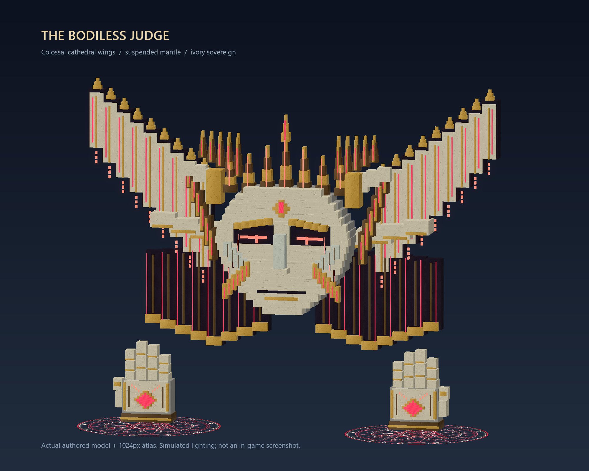

# ผู้พิพากษาไร้ร่าง / The Bodiless Judge

The ancient 241 × 241 temple hosts a multipart world boss: a sculpted ivory mask,
seven bronze/gold crown spires, a layered cathedral crown, recessed crimson eyes,
carved cheek plates, luminous fractures, two plated hands and a gemstone heart.
The enlarged mask now sits between colossal ivory/gold cathedral wings and a
suspended dark mantle with gilded tails and red gems. The 692-cuboid sculpture
uses a shared 1024px atlas and tapered crown tips, with 25 sculpture components, spell planes while attacking
and 52 emerald markers only during judgment. There are no permanent spell planes
on or behind the head, keeping the face clear from every viewing direction.
Java players without the addon see solid block displays using the same dimensions.
Display bounds are computed from every mesh's actual dimensions. This includes
the outward wing vanes and mantle tips, which exceeded the old 36-block box.
Bedrock geometry bounds are centered on each authored mesh, including the head offset.



This preview renders the actual authored meshes and atlas with simulated lighting.
It is not an in-game screenshot. The new crimson circles use the same full-bright
textured-plane technique as Advance Magic's Solar and Chronos. Five original
1024px transparent textures contain nested rings, angular runes, interlocking
stars, attack lanes and rays. Their editable SVG sources are in `evergarden/art/judge`.
Java uses double-sided item displays; Geyser receives the same artwork on stable
world-space particle planes. Dust warnings are shown only to viewers without
usable circle textures. Layered red seals charge above the crown before judgment;
smaller seals summon hand strikes, crossing lanes and annular waves.

Enter the arena in Survival or Adventure and **right-click the existing amethyst
floor at its center with an empty main hand**. This also works in temples generated
by the previous release; installing this build does not regenerate the structure.
The boss stays absent until deliberately summoned. Boss bars, named attackable
parts, floor warnings, sounds and Thai instructions explain the encounter.

## Combat

* Phases 1–2: destroy either hand to open the core for 12 seconds. The gemstone descends
  and its core hitbox shrinks into melee reach, while the mask stays overhead. Breaking the other hand extends
  the opportunity. One broken hand grants **×2 core damage**; breaking both before
  the opening closes grants **×3**. The bonus resets when the core reseals or the
  phase changes; after a missed window a broken hand returns with 45% health.
  Hitboxes move into position immediately in the damage callback. An opening
  cancels the current ordinary attack and gives three seconds to approach;
  ordinary attacks then resume while the heart remains damageable. This replaces
  the previous full 12-second attack pause.
* **Phase 2 adds hand luring.** Two gold rune markers sit near the heart, fourteen
  blocks left/right and six blocks forward. During a lure slam, stand on the rune
  matching the named hand: the red aim follows its chosen player for two seconds,
  then locks for three seconds so they can escape the twelve-block impact area.
  The slam's center must land within the visible three-block rune. Success breaks
  that hand and opens the core at ×2; the other hand gets an early lure opportunity
  to reach ×3 before the opening closes. Luring credits the responsible player
  with the hand's damage contribution. Missing the rune grants no opening, while
  ordinary melee/wand damage to the hands remains a fallback. Gold rune markers
  and their small green rings disappear during Judgment so they cannot be mistaken
  for the four genuine safe sanctuaries.
* Core phase boundaries are 70% and 35%. A large combo reaches the boundary and
  starts the next sealed phase instead of skipping every phase with one cast.
  The phase-two title teaches the lure-and-dodge mechanic after both hands regenerate.
* Phase 3: the face remains recognizable with fragments slowly orbiting behind
  it. The heart and its small hitbox stay at floor level and **remain open**;
  there is no opening/resealing wait. Ordinary three-pulse attacks continue.
  After a five-second approach grace, **Core Rupture** charges for eight seconds.
  Two floating amethyst **interrupt crystals / ผลึกขัดท่า** appear near the heart, nine blocks to either side.
  Land three direct melee strikes on each before the charge ends to interrupt
  it, stun the Judge for **seven seconds**, and deal **×3 core damage** during
  the stun. Their labels and the countdown show left/right progress from 0/3 to 3/3,
  and instructions say to destroy both crystals or leave the red circle, then
  return to the core for ×3 after interruption. Strike counts ignore weapon DPS and party HP scaling. Arrows, wands,
  sweeping attacks and same-tick bonus hits cannot complete the seals.
  If interrupted, no rupture damage occurs. Otherwise, leave the clearly marked
  20-block red circle before it explodes; this is normal damage with the same
  defenses as sky beams, rather than forced death. The heart remains open even
  after a failed interruption. Another rupture becomes due twenty seconds after
  the interruption or explosion, and starts after the current combo completes.
  This mechanic continues after summoned minions die and is completable solo.
* Phase 1 accepts all weapon types. Phase 2 blocks physical projectiles, including
  arrows, but still accepts wand spells. Phase 3 blocks both physical projectiles
  and wand magic, including during the interruption bonus; use melee for the heart.
  These shields apply to the Judge's hands/core, while summoned temple bosses
  retain their normal damage rules.
* Phase 1 opens with **Sky Beams**: 5–10 separate red magic circles at the same
  height, 60 blocks above the floor and clear of the entire crown. Centers stay at least 20 blocks apart, so
  their 18-block casting circles do not overlap. Each has a radius-seven floor
  warning and a thin aim ray, then fires a strong downward beam after 2.2 seconds.
  The overhead casting circle remains visible during the beam impact.
* Ordinary attacks also include targeted hand slams, rotated crossing lanes,
  annular waves and **Lances**, three parallel lanes separated by 22 blocks.
  The dispatcher excludes the previous pattern from its next selection.
  Phase-one slam radius is eleven blocks with a 2.4-second warning; phase-two lure
  slams use twelve blocks with two seconds of tracking plus three seconds to escape.
  Crossing lanes are 10/11/12 blocks
  wide across phases 1/2/3. Wave bands are 14/16/16 blocks wide and center their
  radius near a participant instead of choosing an unrelated random distance.
  Phases 2 and 3 use two- and three-pulse combos. Each new pulse gives a complete
  new warning; cross pulses turn by 30 degrees. A pulse locks its area at charge
  start, except the explicitly signposted tracking portion of the lure slam.
  Spell damage uses sonic-boom damage
  to pierce vanilla armor and enchantments. Resistance, absorption and plugin
  defensive effects remain active. Raw difficulty scaling is compensated on
  Easy/Hard. Ordinary base hits are capped at 70% of Max HP, with sky beams adding
  15% up to an 80% base ceiling. `attack-power-percent: 130` then boosts ordinary
  red-circle attacks by exactly 30%, after those ceilings and before defenses.
  Their boosted ceilings are 91% and 104% of Max HP respectively. A sufficiently
  strong sky beam can kill through normal damage; defensive and life-saving
  effects still apply to red spells. Judgment uses its separate
  forced-death mechanic.

| Phase | Pulses per combo | Cross warning | Wave warning | Recovery after combo |
| --- | --- | --- | --- | --- |
| 1 | 1 | 2.0 s | 2.0 s | 3.4 s |
| 2 | 2 | 1.8 s | 1.9 s | 2.8 s |
| 3 | 3 | 1.8 s | 1.8 s | 2.4 s |

* **Final Judgment is the forced-death signature in every phase**. Phase 1 first
  schedules it forty seconds after summoning, then 230–250 seconds after its previous
  charge. Phases 2/3 first schedule it twelve/twenty seconds after transition, then
  115–135 seconds after its previous charge. Phase 1 uses twice the configured base
  cooldown. Judgment takes priority over due lure/rupture attacks once the current
  attack or earned stun finishes.
  An eight-second warning pauses normal attacks.
  Four green sanctuaries, each radius 16 at distance 48 from the center, are
  shown using green resource-backed seals and vanilla emerald markers. Reach any of them before
  the countdown ends. Even the arena edge is within about 41 blocks of safety.
  Judgment kills participants outside the circles, including flying players,
  despite vanilla armor, Protection, Resistance, absorption, Totems, Phoenix
  Rebirth. It sets HP directly to zero, using the
  same final bypass technique found in True Death. No curse levels, hit stacks,
  True Death configuration or dungeon encounter are reused. Leaving the arena avoids death but does not remove
  the participant's scaling contribution.
* **Phase 3 summons temple bosses**: Shadow Overlord, Astral Archon and Chronos
  Vanguard cycle across one summon per retained participant. Their species,
  crowns, armor, scale and solo boss stats follow the existing temples. They
  target participating Survival/Adventure players and are recalled inside
  the arena. Late participants add one summon each; defeated summons stay dead.
  They drop no gear or XP and do not create independent dungeon runs or rewards.
  Surviving summons disappear on victory, abort, timeout or plugin shutdown.

Only Survival/Adventure participants are attacked. Creative spectators and
uninvolved visitors do not change the difficulty. Join by attacking a part from
inside the arena; a sealed-core hit also enrolls its attacker. The starter is
automatically enrolled. Joining during a charge means joining that live mechanic.

## Balance and configuration

Default solo health: **10,000 core HP**, **1,500 HP per hand**. Effective HP scales
by `1 + 0.65 × (participants − 1)`; four players get ×2.95 and six get ×4.25.
Health is stored in solo units and damage is divided by that factor. Existing
boss-bar progress never jumps when someone joins, dies, leaves or disconnects.
The roster remains fixed upward for that encounter, capped at 16 participants.
Damage does not secretly adjust to measured player DPS.

Incoming damage has **no encounter cap per hit or per second**, including on
summoned bosses. The Titan Hunter Max HP bonus and virtual Power retain their damage.
Advance Magic casts are classified by their active damage context, so a staff
spell attributed directly to a player is not mistaken for a melee hit. Magic
classification takes precedence over a spell's projectile carrier. Core seals
in phases 1–2 and phase boundaries still apply even to very large bursts.

Stationary simulations at 180 incoming damage per second per player finish in
under three minutes with the reduced health and hand bonus. They exclude movement
and warning downtime, and do not measure live server equipment. Tune `world-boss`
values in `plugins/Evergarden/config.yml` after trying the server's actual gear.

On first startup, balance revision 3 migrates the published 20,000 core HP default
to 10,000, and 8,000/8,500 hand HP to 1,500, then removes obsolete `damage-caps`.
Custom HP/power values are preserved, and subsequent startups leave administrator edits alone.
Older configurations also receive the previous revision-1 migration from 40,000
core HP and its 130% spell-power default.
Revision 2 also migrates the former 30-minute fight timeout to unlimited and the
30-second empty-arena reset to a three-minute grace. It preserves custom timer
values and does not repeat the previous health migration.
Revision 4 reduces the published 130-second judgment cooldown to 115 seconds and
the phase-one initial delay from 45 to 40 seconds once, preserving other custom
timings and all revision-3 HP edits. Ordinary combo recovery is one second longer
in every phase; warning durations and ordinary damage remain unchanged.

The hitboxes carry the existing Evergarden LevelledMobs exclusions and encounter
control-resistance marker. Damage events feed shared encounter health, so Java
melee, projectiles and direct Advance Magic damage use the same phase rules.
Hitboxes must be `collidable=true`: Paper also uses this setting for client target
selection and arrow collisions. No AI, gravity or knockback is enabled. Decorative
Bedrock armor stands are unpickable and never intercept attacks; Java viewers do
not receive them. The exposed heart's visual center and real hitbox center agree.
Accepted damage also drains a replenished vanilla health shell, keeping genuine
health-loss accounting available to Advance Magic lifesteal. Shell damage stops
at one HP; excess burst still counts against encounter health, while lifesteal
uses actual shell HP loss. Vanilla damage-over-time without a player cause does
not drain the encounter health pool.

The full default config is under `world-boss`. `enabled: false` stops active fights
and disables summoning while retaining the temple. Exposure, HP, participant
scaling, attack damage, judgment timing, safe radius and rewards are configurable.
Safety clamps keep the lethal warning at least eight seconds and circles at
least radius 16. At most two bosses can be active by default. Active encounters
have no hard time limit (`fight-timeout-seconds: 0`). A positive value enables an
optional admin limit, with remaining time shown on the boss bar and in `boss status`.
If every participant is dead, disconnected or outside the arena, the fight waits
three minutes (`empty-reset-seconds: 180`) before resetting. Online participants
receive a return countdown, and returning preserves HP, phase and contributions.
Missing living hitboxes are recreated with their current virtual encounter HP.
All termination paths report a specific reason to online participants and the
server log; `world-bosses.yml` also records the latest stop reason per temple.

## Commands, rewards and storage

Admins can use **`/evergarden test` → World Boss Test** (the amethyst block) to
start or reset directly in phases 1, 2 or 3, force a phase-two lure, signature
Judgment in any phase, or a phase-three rupture immediately,
heal, receive a plain unbreakable practice sword, or stop the test encounter.
Starting a test automatically teleports to the arena, enters Survival when needed,
and heals the starter. Ending the test restores the starter's original game mode.
Tests run the same combat mechanics with a visible `[TEST]` boss bar, grant no
rewards, and leave the site's real cooldown ledger unchanged. They can bypass an
existing cooldown, but cannot replace an active real encounter. Repeating a phase
button clears the previous test's entire body, summons, seals and warnings.
The owner can stop a test even after leaving the arena. Every control checks admin
permission again when used.

* `/evergarden tp boss-temple` — admin teleport to the existing safe entrance.
* `/evergarden boss status` — encounter state or remaining temple cooldown.
* `/evergarden boss claim` — claim queued rewards after making inventory space.
* `/evergarden boss start` — admin test summon; bypasses cooldown only. Use Survival.
* `/evergarden boss stop` — admin abort and remove all runtime entities.
* `/evergarden boss pack` — pack host URL, hash and your client status; console also works.
* `/evergarden boss pack resend` — request the Java addon again.

## Installing the graphics

Replace `plugins/evergarden.jar` and `plugins/advance-magic.jar` with both JARs
from `dist` and restart. Advance Magic 1.5.1 adds the terrain permission event
used to keep spell-created lava and Sculk out of the protected temple.
The Java addon, updated Bedrock pack and mappings are embedded in `evergarden.jar`.
The existing published relic pack and its URL/hash are preserved.

For Java, allow **TCP 8189** from players to the server. The addon host chooses
the hostname used to join Minecraft. For proxies/NAT, set
`world-boss.visuals.pack.host.public-host` to the reachable server address, or
`host.public-url` to an HTTPS reverse-proxy base. An external `pack.url` must host
the exact extracted `plugins/Evergarden/resource-packs/judge-java.zip`; the bundled
SHA-1 is computed automatically. Accept the pack prompt and check `boss pack`.
No configured public address means the addon cannot be offered from console;
player connections supply the hostname. Host failure/decline/reload failure keeps
the Java fallback and fully working hitboxes. `pack.enabled: false` disables the addon.

Local Geyser receives the updated Evergarden pack/mappings during `onLoad`.
Restart Geyser and reconnect Bedrock clients; the pack content version is 3.24.1.
The Judge helmet attachables now use Bedrock's vanilla `armor` material, matching
[Mojang's helmet definition](https://github.com/Mojang/bedrock-samples/blob/main/resource_pack/attachables/iron_helmet.json).
This is a rendering compatibility adjustment; device rendering remains a manual check.
External Geyser needs the extracted pack and mapping files copied to that instance.
`/evergarden boss pack` identifies `cathedral-wings-v2`, fourteen models and
twenty-five sculpture components, alongside the Java pack hash and client status.
If the installed server reports an older revision, replace its JAR and restart.
Java players can use `/evergarden boss pack resend`; an external Geyser needs
the current `evergarden-bedrock.mcpack` and `geyser-mappings.json` as well.
Colored Bedrock filaments use original glint particles via Geyser's optional bridge;
an incompatible bridge falls back to vanilla particles without stopping the fight.

The admin-only `/evergarden test` → World Boss Test menu also has a Feather to
summon a 10-minute Seraph model preview four blocks ahead and Shears to remove it.
Its white hair, blue eyes, gold-trimmed robe and large layered wings are separate
`judge_seraph_idle` and `judge_seraph_cast` item models. An invisible, AI-disabled
Witch anchors the preview and cannot throw potions. The pose changes to spellcasting
every five seconds. Normal witches, the live Judge fight, rewards and cooldowns are
unaffected. Each admin owns one preview; it disappears on logout, removal or expiry.
Java requires the Judge addon pack to finish loading before the summon button works.
Bedrock requires the updated Evergarden pack and Geyser mappings.
The `seraph-feathered-v2` preview uses a 1024×1024 atlas, layered white hair,
embroidered robe panels, an octagonal gold halo and continuous tapered feathers.
Both export paths preserve the rotated feather pivots and UV crops. The local
preview renderer reads the final Java pack with textures and depth testing.

Victory sets a four-hour site cooldown. Every participant credited with positive
hand/core damage receives one random Advance Magic core, two Evergarden keys and
1,500 XP by default. Each player rolls independently from all available cores with
equal chances, including Mythic cores.
Being nearby or damaging only summoned temple bosses does not qualify. The exact
core ID is drawn once at victory and saved; claiming cannot reroll it. Rewards
accumulate over multiple wins until there is room for the entire item bundle.
Rewards for offline/dead players or full inventories remain in `world-bosses.yml`.
They are offered on join/respawn or with `boss claim`. Atomic ledger writes prevent
repeated claims across a restart. Runtime sculptures are nonpersistent and cannot
place or drop blocks. Victory, abort, plugin shutdown and empty timeout remove
hitboxes, sculpture, boss bars, markers and owned chunk tickets. The encounter
never edits the protected arena blocks.

## Verification

`tests/ancient-judge/run.py` boots isolated Paper twice. The probe uses actual
NMS sword attacks, moving vanilla arrows, selection rays, Advance Magic calls,
pack download/acceptance/reload-failure checks, actual Titan Hunter bonuses,
uncapped melee/projectile/magic/other damage, same-tick multi-hit spells,
phase-specific projectile/wand shields, hand-break core bonuses, aerial circle
spacing and beam damage, three horizontal lance rays, a high-HP player with
Totem/Phoenix simultaneously equipped, the live
judgment countdown, spell placement above the crown, larger slam damage beyond
the old radius, rotated two-pulse combos, attacks during core openings,
resource-backed seals, green sanctuary safety, three phase
transitions, always-open final heart, real sword strikes on interruption seals,
seal repair, failed-charge damage boundaries, exact stun timing and bonus damage,
admin phase shortcuts, test reward/cooldown isolation and cleanup, menu permission
checks, temple boss counts/species, late participant summons, no loot
or respawns for defeated summons, one core per positive contributor, queued rewards
for dead/offline players, inventory capacity, unchanged rolls after restart,
repeated-claim prevention, entity/ticket cleanup and persisted cooldowns.
Long-fight regressions simulate an hour of active combat, remove a hitbox, leave
and return after a minute, check the exact abandonment grace boundary and test
an optional admin timeout plus manual/disabled cleanup reasons. Pure rule
checks include sprint escape margins for each tuned area, rotated damage edges,
deterministic DPS simulations and every angle around the arena
edge for sanctuary reachability. The temple generation/protection suite remains
applicable; the structure itself has not changed.

The installed Geyser suite checks sanctuary materials and no-gravity/NO_AI
translation across five Bedrock block palettes, crimson glints, horizontal/upright
spell packets with nearby emitters and exact world centers,
and all fourteen direct custom model routes, alongside the existing Mythic spell suite.
The equipment checks also use the real Judge item factory and Geyser armor stand:
spawn and armor packet order, custom helmet identifiers, registered head-slot wearable
components, and invisible carriers with nonzero scale across every item protocol table.
`evergarden/tests/check_judge_assets.py` verifies Java element limits, shared atlas,
Bedrock/Java world-space geometry parity, transparent spell textures and weakpoint placement. These are real
translation checks without a client connection; visual inspection on a Bedrock
device remains manual.

```text
python tests/ancient-judge/run.py --paper-template <disposable-server> --garden-jar <evergarden.jar> --magic-jar <advance-magic.jar>
```
