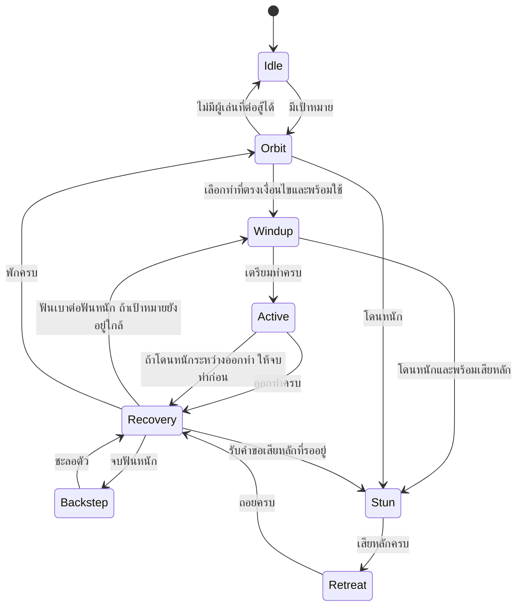

Current combat rules: [Arkhaia e2.70 / Six Rivers](arkhaia-worldboss.md). Earlier revision notes below are historical.

# Arkhaia: การตัดสินใจ การเคลื่อนที่ และแอนิเมชัน

ตั้งแต่ `e2.69` เปลี่ยนเป็นเวทคุมลานเป็นหลัก ไม่มีคอมโบฟันแล้วถอยหลังตามคำอธิบายรุ่นก่อนด้านล่าง ดู [กติกาเฟส จุดอ่อนด้านหลัง และเวทปัจจุบัน](arkhaia-worldboss.md)

เวอร์ชัน `3.0.0-e2.66-arkhaia-combat-tempo` ใช้สามส่วนแยกกัน: [ArkhaiaBrain.java](../evergarden/src/main/java/com/example/voidscape/boss/ArkhaiaBrain.java) เลือกท่าและคุมเวลา, [ArkhaiaSteering.java](../evergarden/src/main/java/com/example/voidscape/boss/ArkhaiaSteering.java) คำนวณความเร็ว, และ [ArkhaiaAnimation.java](../evergarden/src/main/java/com/example/voidscape/boss/ArkhaiaAnimation.java) เลือกเฟรมตามเวลาและระยะที่เดินจริง ทั้งหมดถูกเชื่อมใน [ArkhaiaBoss.java](../evergarden/src/main/java/com/example/voidscape/boss/ArkhaiaBoss.java) บน main thread ทุก tick แทนการขยับทุก 2 tick แบบเดิม



`Idle` ยกเลิกท่าค้างและล้างวงเวทย์เมื่อไม่มีผู้เล่น Survival/Adventure ที่ยังมีชีวิตอยู่ในลาน การเสียเป้าหมายใช้กฎเดียวกันจากทุก state ส่วนเลือดบอสเป็น virtual HP 7,000 และมีป้ายกัน LevelledMobs ตามเดิม

การรักษาระยะใช้ช่วง **5–7 บล็อก** เป็น dead band: ใกล้เกินไปให้ถอย ไกลเกินไปให้เข้า และเมื่ออยู่ในช่วงให้เดินวนเป็นหลัก เวกเตอร์เข้าหาเป้าหมายคือ `n=(dx,dz)/distance`; เวกเตอร์เดินข้างคือ `t=(-n.z,n.x)` รวม `n * radial + t * orbitSign * tangent` แล้วจำกัดความเร็ว บอสเปลี่ยนฝั่งเดินวนทุกประมาณ 5 วินาทีโดยค่อย ๆ ลดความเร็วเดิมก่อนเร่งอีกทาง ความเร่งปกติจำกัดที่ `0.035 block/tick²` จึงไม่เปลี่ยนความเร็วทันที ตัวควบคุมจริงตรวจบล็อก ความสูง พื้นรองรับ และขอบลาน 36 บล็อกก่อนขยับแต่ละก้าว รวมถึงลองมุมหลบเมื่อเจอสิ่งกีดขวาง

นี่เป็นตัวควบคุมสำหรับลานเปิดที่มีโมเดลขนาดใหญ่ ไม่ใช่ระบบค้นหาเส้นทางผ่านเขาวงกต ขนาดตัวต้องถูกนำไปคิดกับ clearance เสมอ การเปิด vanilla AI พร้อมกับตัวควบคุมนี้จะทำให้มีผู้เขียนตำแหน่งสองชุด จึงใช้ scheduler ตัวเดียวกับ Slime anchor ที่ปิด AI อยู่

หากเปลี่ยนไปใช้ carrier ที่เปิด AI ให้เลือกเพียงหนึ่งวิธี:

- [ArkhaiaGoal.java](examples/ArkhaiaGoal.java) เป็น Paper `Goal<Mob>` adapter ประกาศ flag `MOVE/LOOK` แล้วเรียกตัวควบคุมเดียวกันจาก `tick()` API อ้างอิง: [Goal](https://jd.papermc.io/paper/1.21.11/com/destroystokyo/paper/entity/ai/Goal.html) และ [MobGoals](https://javadocs.papermc.io/paper/1.20.6/com/destroystokyo/paper/entity/ai/MobGoals.html)
- [ArkhaiaPathfinderGoal.java](examples/ArkhaiaPathfinderGoal.java) เป็น NMS `Goal` สำหรับ Mojang-mapped `PathfinderMob` ใช้ Navigation เมื่อไกลและ MoveControl.strafe เมื่อใกล้ พร้อม callback สำหรับระบบสกิล/แอนิเมชัน ตัวอย่างทั้งสอง compile กับ dependency Paper 26.2 ใน workspace นี้ แต่ไม่ได้ติดตั้งซ้อนกับ scheduler ของบอสจริง Slime เดิมไม่ได้เป็น `PathfinderMob`; ตัวอย่าง NMS จึงใช้กับ carrier เช่น Zombie/Husk แทน และต้องตั้ง collision/โมเดลให้ตรงใหม่

ตัวอย่างการติดตั้ง Paper Goal บน carrier ที่ปลั๊กอินเป็นเจ้าของโดยเฉพาะ:

```java
// Choose this driver OR the scheduler, never both.
carrier.setAI(true);
Bukkit.getMobGoals().removeAllGoals(carrier);
Bukkit.getMobGoals().addGoal(carrier, 0,
    new ArkhaiaGoal(plugin, carrier, controller::tick, controller::isActive));
```

ตัวอย่างแกนการคุมระยะและความเร็วจาก implementation จริง:

```java
double radial = distance > 7 ? (distance - 7) * .35
              : distance < 5 ? (distance - 5) * .5 : 0;
radial = Math.clamp(radial, -1, 1);
double desiredX = nx * radial - nz * .8 * orbitSign;
double desiredZ = nz * radial + nx * .8 * orbitSign;
// Normalize/limit desired speed, then limit the change in velocity per tick.
```

ระบบเลือกสกิลสุ่มแบบถ่วงน้ำหนัก **เฉพาะตอน Orbit และผ่านช่วงพักแล้ว** ไม่สุ่มใหม่กลางท่าและไม่สร้าง scheduled task แยกสำหรับแต่ละ hit คูลดาวน์เป็น deadline (`readyAt`) ต่อท่า จองตั้งแต่เริ่มเตรียมท่า แม้ถูกขัดก็ไม่รีเซ็ตให้กดซ้ำทันที หากมีหลายตัวเลือก จะตัดท่าที่เพิ่งเลือกออกเพื่อลดการใช้ซ้ำ

| ท่า | เงื่อนไขเริ่ม | น้ำหนัก | คูลดาวน์ | เตรียม / ออกท่า / พัก | ดาเมจฐาน |
|---|---|---:|---:|---|---:|
| ฟันเบา | ระยะ ≤7.5 และเห็นเป้าหมาย | 6 | 65 tick | 9 / 7 / 4 tick | 0.8× |
| ฟันหนัก | ต่อจากฟันเบา ถ้าเป้าหมายยัง ≤10 และมองเห็น | ต่อคอมโบ | ใช้รอบคอมโบเดียวกัน | 13 / 9 / 5 tick แล้ว Backstep 8 tick | 1.25× |
| Violet Rift | ระยะ 7–26 และเห็นเป้าหมาย | 3; เพิ่มเป็น 6 เมื่อ HP <50% | 160 tick | 22 / 12 / 8 tick | 1.05× |
| Dreadrose Nova | HP ≤65%, ระยะ ≤13 | 4 | 210 tick | 20 / 12 / 8 tick | 0.95× |

ฐานดาเมจอยู่ที่ `arkhaia.combat.attack-damage` ค่าเริ่มต้น 12; ฟันจึงเป็น 9.6/15 และเวทเป็น 12.6/11.4 ก่อนระบบป้องกัน/ความยากที่เกี่ยวข้อง Rift ล็อกวงรัศมี 3.8 บล็อก ณ ตำแหน่งผู้เล่นเมื่อเริ่มร่าย ส่วน Nova ล็อกวงรัศมี 9 ณ ตำแหน่งบอส ไม่เลื่อนพื้นที่ตามผู้เล่นตลอดการร่าย ดาเมจออกครั้งเดียวใน ACTIVE (tick 3 / 5 / 5: Light / Heavy / Magic) ตรวจระยะ ความสูง line of sight และ game mode ซ้ำตอนโดนจริง ผ่าน Bukkit DamageSource เพื่อให้เกราะ การป้องกัน และ event cancellation ทำงาน

คอมโบหลักเป็น `Light windup → Light active → Recovery → Heavy windup → Heavy active → Recovery → Backstep → Recovery → Orbit` ถ้าผู้เล่นหนีไกล ท่าฟันหนักจะไม่ถูกต่อโดยอัตโนมัติ บอสมีช่วง Orbit 8–14 tick ระหว่างรอบการตัดสินใจใหม่ จึงมีเวลายืนตำแหน่งและอ่านท่า

โดนครั้งเดียว ≥`stagger-threshold` (เริ่มต้น 350) หรือรวม ≥1.7 เท่าภายใน 20 tick จะขอ Stun 10 tick → Retreat 10 tick → Recovery 4 tick มีคูลดาวน์เสียหลัก 100 tick ถ้าโดนระหว่าง ACTIVE จะจบ release ก่อนแล้วค่อยเล่นอาการเสียหลัก แต่ windup ที่ยังไม่ออกดาเมจถูกขัดได้

ระบบท่าสำรองเก็บ phase ต่อเนื่องตามระยะที่เดินจริง มี stride 8 เฟรม, hover 4 เฟรม, blade 9 เฟรม และ channel 4 เฟรม การเงื้อ/ฟัน/คืนท่าใช้ smoothstep และเฟรมปลายของท่าก่อนตรงกับเฟรมแรกของท่าถัดไป ตั้งแต่ e2.66 บอสหมุนตามผู้เล่นระหว่าง windup จนเหลือ 3 tick สุดท้าย แล้วล็อกไว้จนจบ release เพื่อเปิดโอกาสให้หลบ Model, hitbox และ Bedrock carrier ใช้ตำแหน่งเดียวกันทุก tick; การลอยใช้ vertical spring/damping แทนการกระโดดระดับความสูงทันที ระบบข้อต่อสำหรับ Java อธิบายใน [Arkhaia Model Engine](arkhaia-model-engine.md)

เฟรมเหล่านี้ยังเป็น discrete mesh บนระบบ ItemDisplay/helmet เดิม ไม่ใช่ skeletal blending เต็มรูปแบบ จึงลดการตัดท่าได้มากกว่าแบบสองเฟรมเดิม แต่ยังต้องตรวจความรู้สึกจาก client จริงและปรับเวลาหรือเพิ่มเฟรมต่อได้

เอฟเฟกต์อยู่ใน [ArkhaiaEffects.java](../evergarden/src/main/java/com/example/voidscape/boss/ArkhaiaEffects.java) ใช้ renderer `JudgeSigils/JudgeAether` ที่มีอยู่เพื่อให้ Java เห็น textured planes และ Bedrock ได้ world-space particles แบบเดียวกัน งานภาพใหม่เลือกแค่ outer bands ของ Judge และ annular constellation fragments จาก `advance-magic/art/effects/legendary/lunar_constellation.png` เติมกลีบเปิดหกแฉกและปรับโทนม่วง ชื่อใหม่คือ `arkhaia_rose`, `arkhaia_orbit`, `arkhaia_ray` ไม่คัดลอกลำดับสกิลเต็มชุดของคทาหรือผู้พิพากษา และไม่เรียกใช้สกิลผู้เล่นโดยตรง

วงพื้นแสดงขอบเขตที่โดนจริง ส่วนลวดลายด้านในและวงขยายเป็นรายละเอียดประกอบ สัญญาณเสียงเริ่มร่าย, sweep ตอนฟัน, impact หนัก, เสียงปีกตอนถอย และอนุภาคเมื่อ Stun ผูกกับ state entry หรือ impact tick เดียว ใช้ plane แบบ reuse สูงสุดสามชิ้นต่อบอสและปิดเมื่อพัก ขัดท่า ไม่มีเป้าหมาย ตาย หรือ shutdown

ทดสอบด้วย `tests/arkhaia/run.py`: pure Java ตรวจลำดับคอมโบ คูลดาวน์ เงื่อนไข HP การขัดท่า ความเร่ง และรอยต่อแอนิเมชัน; Paper probe ตรวจเหตุการณ์อัญเชิญ การเคลื่อน การโดน/หลบ การยกเลิกดาเมจ วงเวทย์ และ cleanup ส่วน `check_faction_boss_assets.py` ตรวจ legality/UV/pivot/scale ของทุกเฟรมบนสอง client ไม่มีการเชื่อมต่อ Bedrock client จริงในการทดสอบอัตโนมัติ
