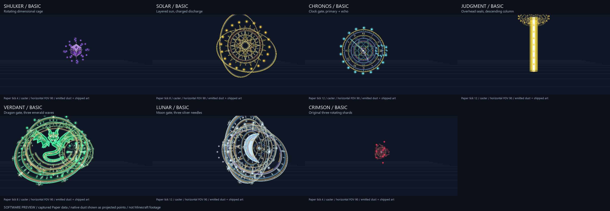

# Dual-mode wand casting

Advance Magic 1.7.1-distinct-basic-patterns. Bedrock content version 2.11.2.

Normal input casts the basic attack. Sneaking input casts the original main spell.
Both modes support use item, swing/tap in air, tap an opponent, interact with an
entity and swap hands. Main-hand wands take priority over offhand wands. Existing
explicit casts().cast(...) and spells().cast(...) APIs still request main spells.

## Pricing and damage budgets

| Pricing family | Mana | Shared cooldown | Maximum raw PvE damage per opponent |
|---|---:|---:|---:|
| Ordinary bolt family | 3 | 1.40 s | 14 |
| Ordinary beam family | 3 | 1.25 s | 12 |
| Nearby / ground family | 4 | 1.75 s | 10 |
| Mythic | 5 | 1.75 s | 18 |
| Legendary | 7 | 2.25 s | 24 |

These are pricing families, not a restriction to three attack shapes. Each wand
now has its own timing, path and visual signature. Damage cores still grant up to
+30%, captured at cast time. Basic damage against players is multiplied by 0.6
before their normal defenses: a Legendary basic has a 14.4 raw PvP budget, or
18.72 with maximum damage upgrades.

A per-cast ledger caps every opponent's total damage across multiple projectiles,
channels, cone pulses and overlapping areas. Three Lunar needles each deal eight
damage, rather than three full 24-damage hits. Chronos splits 18 into a 60% primary
shot and 40% delayed echo. A missed shard or an opponent leaving a cone reduces the
damage actually dealt. Small blasts and directional attacks use bounded target
counts. Iron's nearby nova still hits at most six opponents; direct bolts hit the
first eligible opponent, and Sonic's moving rings check up to three aligned
opponents per wave.

All basics respect walls, allies, disabled PvP, cast/affect permission events and
world/chunk bounds. Geometry and target policy are checked again after permission
callbacks. Closing an effect during damage stops its remaining shots and artwork.
No basic grants healing, buffs, roots, levitation, lingering damage-over-time or
terrain changes.

Basics share one persisted cooldown across every wand. Switching items or
reconnecting does not reset it. Main mastery/cooldown upgrades do not speed up
basic attacks. Basics cost no wand durability and grant no main mastery; a depleted
wand still requires repair before either mode can cast.

## The 21 attack patterns

| Wand | Basic behavior |
|---|---|
| Lightning | Instant zigzag electric arc |
| Frost | Three simultaneous spreading shards; strongest when all three connect |
| Shadow | Short forward crescent slash; excludes enemies behind the caster |
| Nature | Gently arcing thorn seed with rotating green petals |
| Earth | A sequence of ground eruptions advancing up to eight blocks |
| Dragon | Three short forward cone pulses over six ticks |
| Void | Slow orbiting dimensional orb, followed by a small implosion |
| Sonic | Expanding sound rings move forward and pierce aligned opponents |
| Blaze | Three separately timed fire shots |
| Wither | Slow corkscrew soul projectile |
| Shulker | Moving violet prism with crossed authored faces and a rotating particle cage |
| Meteor | High arcing ember landing at the captured aiming point, with a small blast |
| Iron | Expanding nearby silver nova |
| Vex | Two spirit projectiles curve apart and converge on the captured aiming point |
| Guardian | Locked beam pulses at ticks 2, 6 and 10, with continuous visibility checks |
| Solar | Layered, tilted sun orbits charge for eight ticks before a forward discharge |
| Chronos | Visible clock gate with two moving hands, a primary shot and delayed echo |
| Heaven's Judgment | Two authored seals above the captured target point and a narrow descending column |
| Verdant | Front-facing dragon gate with a tilted halo; three moving emerald wavefronts |
| Lunar | Moon gate, tilted orbit and constellation; three staggered silver needles |
| Crimson | Original three rotating authored shards, sharing one projectile impact |

Solar, Chronos, Verdant and Lunar gates are placed in front of the caster and to
the side of the aiming line. Their large artwork stays visible from the casting
player's view. Moving projectile art is separate from the cast gate, so it has a
recognizable flight path. Judgment uses the original dedicated horizontal-seal
and vertical-column render paths on both clients.

Shulker's new prism has an editable SVG source and a 1024px transparent PNG,
created with the repository's vector-art exporter. Regenerate it with:

~~~powershell
python tools/shulker_basic_art.py
python advance-magic/tools/build_packs.py
~~~

The new prism is owned only by Advance Magic's pack, with a Java item model and
Bedrock world-space particle definitions. Existing core/wand item mappings are
unchanged. Reconnect and accept the rebuilt pack after replacing the plugin;
Bedrock content version 2.11.2 invalidates its previous content cache.

Effects last at most 80 ticks, have at most twenty authored displays, and use a
bounded particle budget. The basic-casting config section controls pricing,
PvP scaling and effect/target limits. Both event types expose isBasicCast(); their
existing two-argument constructors still represent main casts.

## Verification and previews

The final version passed 301 real Paper basic-attack checks. They exercise all 21
input modes, damage budgets, upgrades, cooldowns, permission policy, walls, shape
differences, separate shot timing, delayed echoes, piercing waves and cleanup.
The existing main Legendary suite also passed 5,726 checks after the helper update.
The package builder compares every shipped Advance Magic class with the passing
Paper-tested JAR before updating local release artifacts.

~~~powershell
python advance-magic/tests/run_basic_casting_checks.py --source-server output/basic-casting-validation-v7-20261012
~~~

The probe records ItemDisplay transformations and actual outgoing Java dust
particle packets at ticks 0, 4, 8, 12, 16 and 24. Native dust points and asset
geometry are projected into software previews; they are not Minecraft footage,
and do not reproduce client lighting, interpolation or random particle sprites.
Connected Java and Bedrock client appearance still needs an in-game check.

[Animated caster preview](../previews/mythic-basic-caster-preview.gif) ·
[All 21 basic patterns](../previews/distinct-basic-attacks.png)

~~~powershell
python tools/preview_basic_casting.py output/distinct-basics-final-validation-20261013/basic-runtime-scenes.json --scope mythic --camera caster --animate --output previews/mythic-basic-caster-preview.png
~~~
