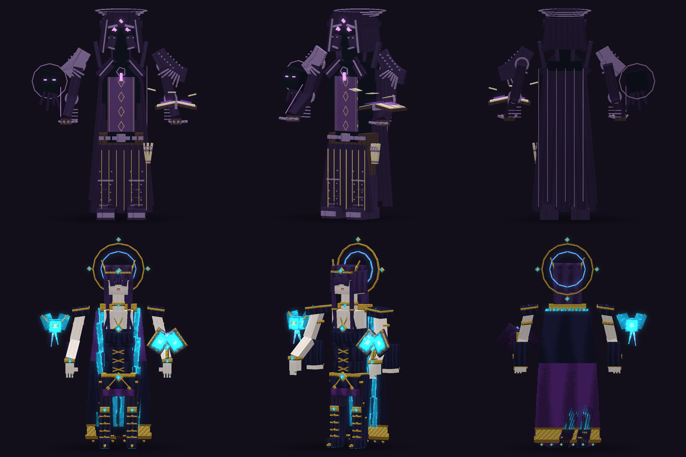
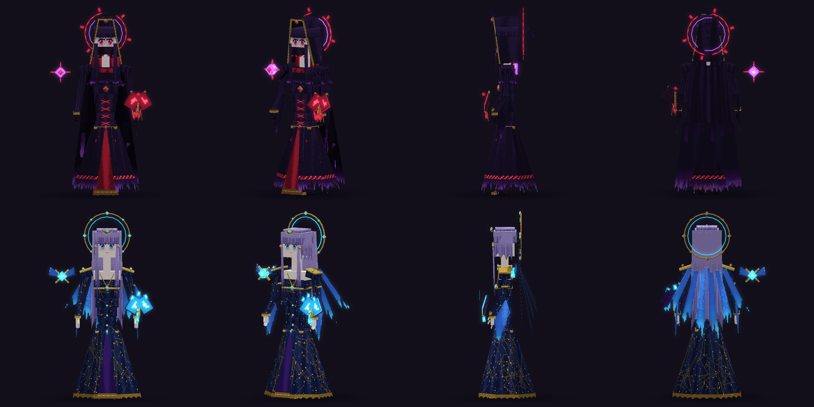

# Evergarden 3.0.0-e2.153-boss-balance

## Malefeasance: โมเดลใหม่ทั้ง 2 ร่าง

- **ร่าง 1 (Veiled Hexer):**
  - ฮู้ดแหลมกับผ้าคลุมหน้าสีเข้ม และวงแหวนแตกสีแดงเลือด
  - ชุดคลุม 8 แผงขาดรุ่ยปลายเป็นเงา มีชายผ่าหน้าสีแดง
  - ตำราผูกโซ่ และดวงตาลอยข้างตัว
- **ร่าง 2 (Astral Ascension):**
  - ผมเงินม่วง มงกุฎจันทร์เสี้ยว และวงแหวนทอง
  - ชุดลายกลุ่มดาว แขนเสื้อแสงดาว และริบบิ้นแสง 6 เส้นเป็นปีก
  - ดาวบริวาร
- แต่งเพิ่มบนโครงกระดูกเดิมและท่าเดิมทั้ง 17 ท่า ฝั่ง Java ใช้ ModelEngine blueprint ส่วน Bedrock ใช้ pack **3.61.0**
- เอวแคบลงและแขนชิดตัวขึ้น ทำให้กรอบโจมตีระยะประชิด (BODY) แคบลงจาก ±11 เหลือ ±8.5
- โค้ดสร้างโมเดล: `evergarden/tools/malefeasance_v4.py`

## ความถี่การวาป

| | เดิม | ใหม่ |
|---|---|---|
| เวลาเตือน (วงพอร์ทัล) ก่อนวาป | 6 tick | 16 tick (0.8 วินาที) |
| ระยะห่างระหว่างการวาป | 42 tick | 150 tick (7.5 วินาที) |
| วาปครั้งแรกหลังเริ่มสู้ | 42 tick | 90 tick |

## Arkhaia: ลูกน้องจากพิธีแม่น้ำ

- ภูตที่ Arkhaia เรียกมี HP 50% และดาเมจ 75% ปรับได้ที่ `arkhaia.ritual.minion-health` และ `arkhaia.ritual.minion-damage`
- Phlegethon ปรับตัวต้านอาวุธเดิมได้สูงสุดแค่ครึ่งหนึ่งในพิธีนี้
- การแยกร่างของ Acheron, Styx ตอนคลั่ง และหลอด HP ของ Malefeasance คิดตาม HP ใหม่
- บอสใน Sanctuary ไม่เปลี่ยน

## วิหาร Vault (วิหารเล็ก)

- **ไม่ดึงผู้เล่นกลับแล้ว:** กระโดด, Wind Charge และ Mace ใช้ได้ทุกที่เหนือพื้นลานในวงรัศมี 21.5 ช่อง ถึงความสูง Y 145
- **ตีบอสไม่ได้ (แต่ไม่วาป ไม่ทำดาเมจผู้เล่น):** เมื่อยืนบนเสาหรือซุ้มเหนือ Y 102.5, อยู่ใต้พื้น หรืออยู่นอกวง ข้อความเตือนขึ้นที่ action bar
- **รีเซ็ต:** ถ้าไม่มีใครอยู่ในลานครบ 15 วินาที วิหารรีเซ็ตเหมือนวิหารใหญ่ ปรับได้ที่ `structures.minor.leave-reset-seconds` (5–120)
  - ระหว่างนับถอยหลังมีเสียงเตือนและตัวเลขบน action bar
  - มอนหยุดนิ่งจนกว่าจะมีคนกลับเข้าลาน
- **มอนที่หลุดวง** (เกินรัศมี 19.2) ยังวาปกลับกลางลานเหมือนเดิม

## การทดสอบ

- **Paper (`tests/arkhaia/run.py`):**
  - `--malefeasance` 55 ข้อ
  - `--hitbox` 80 ข้อ
  - `--arkhaia-native` 53 ข้อ
  - `--cocytus` 71 ข้อ
  - `--pack-order --pack-unreachable` 25 ข้อ (โหลด pack จากสำเนาบน GitHub)
- **Paper (`tests/vault-arena/run.py`, ใหม่):** 16 ข้อ
- **สคริปต์ตรวจ:**
  - `check_banshee_wail` 30515 ข้อ
  - `check_evergarden_bosses` 34269 ข้อ
  - `check_phlegethon_skills` 1860 ข้อ
- `check_acheron_split_assets` ล้มเหลวที่ bone halo ของร่างแยก Acheron แต่ล้มเหลวแบบเดียวกันตั้งแต่ก่อนรุ่นนี้

## การ build

`python tools/build_boss_balance_release.py --promote`

- ทับบน e2.152 โดย compile ใหม่เฉพาะ 5 คลาส:
  - MalefeasanceEncounter
  - ArkhaiaMinions
  - ArkhaiaBoss
  - RiverTrials
  - DungeonManager
- แทนที่ไฟล์เหล่านี้:
  - blueprint 2 ไฟล์
  - Bedrock pack
  - pack-hashes.json
  - judge-design.json
  - plugin.yml
- entry อื่นใน JAR เหมือนเดิมทุกไบต์
- จากนั้นรัน `python tools/publish_pack_mirror.py --release` และ embed แล้ว sha256 `4dc3af2c1a998436…`
