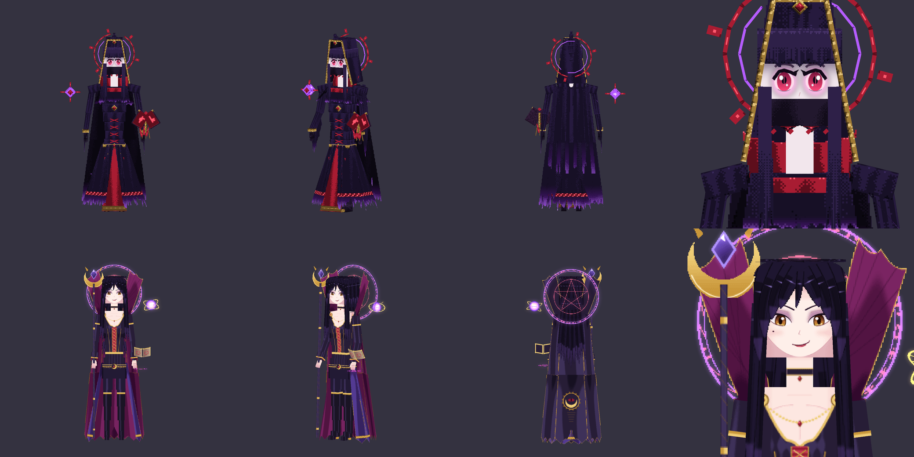
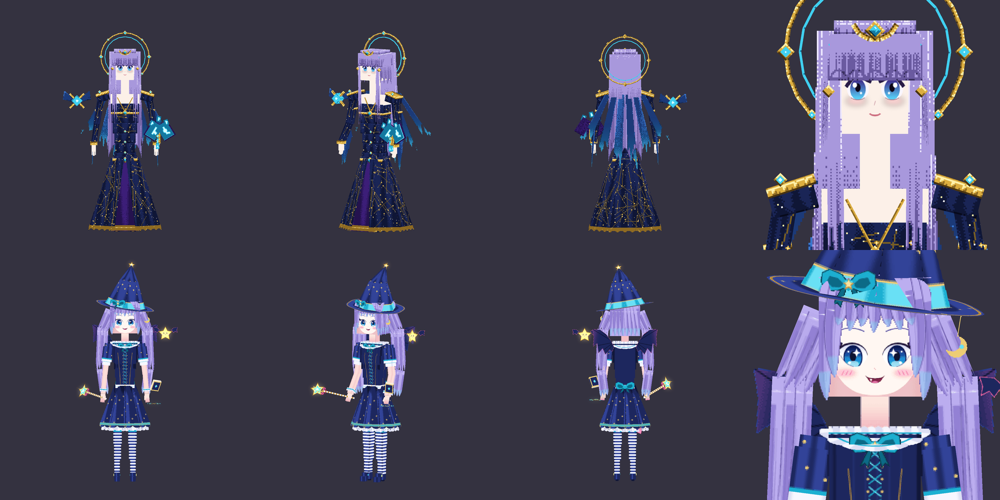

# Evergarden 3.0.0-e2.156-malefeasance-v5

Both forms of Malefeasance are redrawn. Only the models change: the code, the 17 animation clips,
the bones and the hitbox bones are the same as in e2.153/e2.154.

## Phase 1: the Sin Witch (in the style of Merlin, The Seven Deadly Sins)

- Long black hair with violet highlights: centre-parted curtain bangs, two long locks over the
  chest and five locks down the back.
- An anime face: half-lidded amber eyes with a winged liner, high arched brows, a sly smirk and a
  beauty mark.
- A black corset gown with gold trim, a crimson laced panel and a gold chain across the collarbones.
- An open-front violet skirt with a plum lining, over thigh-high boots.
- A violet cape with an emblem on the back and a tall, fan-shaped, wine-lined collar behind the head.
- Props: a crescent staff in the left hand, a floating grimoire and a red spell circle by the
  right hand, a violet orb with gold rings, and a pentagram rune circle behind her.

## Phase 2: the Star Imp (cute and a little wicked)

- A big midnight witch hat (an 8-sided cone whose tip bends back) with a cyan band and bow, a
  star at the tip and a crescent charm.
- Lilac twin tails with cyan tips and cyan bows.
- Big starry cyan eyes, hatched blush and an open grin with one fang.
- A navy dress with a frilled collar, a chest bow and puffed sleeves; a star-print skirt over a
  white lace petticoat.
- Striped stockings and Mary Janes.
- Bat wings (on the veil bones, so they flap), a devil tail with a heart tip and a back bow.
- A star wand angled forward and out (at least 4.2 units clear of the face in every clip), a
  small spellbook and a star sprite with bat wings.

## How it is built

- `evergarden/tools/malefeasance_v5.py` builds both blueprints. It uses
  `evergarden/tools/anime_forge.py`, a new shared tool that bakes textures texel by texel:
  - It projects front, back and side paintings onto the cuboids, so stacked pieces read as one
    surface, the same approach as the e2.148 Seraph.
  - It maps paintings onto thin sheets for the hair, skirts, collar, wings and so on.
  - The output is a palette PNG, so each atlas is about 100 KB.
- ModelEngine drops the per-cube `shade` flag, so Minecraft applies its normal entity lighting in
  game. The paint therefore carries no baked lighting.
- `evergarden/tools/preview_malefeasance.py` renders previews.
  - Set `MC_LIGHT=0` or `MC_LIGHT=90` to simulate Minecraft lighting with the boss facing north
    or east.
- Display models in real ModelEngine: 49 for phase 1 and 77 for phase 2 (v4 had 102 and 83).
- The Bedrock pack is 3.62.0, built with
  `tools/update_river_bedrock.py arkhaia_malefeasance arkhaia_malefeasance_phase2 --version 3.62.0`.
  Only the Malefeasance geometry, textures and manifest changed.
- The release is built with `python tools/build_malefeasance_v5_release.py --promote`, an overlay
  on `dist/evergarden-3.0.0-e2.154-pet-grounding.jar`. Every other entry stays byte-identical.
- After that, run `python tools/publish_pack_mirror.py --release --magic-jar dist/advance-magic-1.34.1-bedrock-pack-repair.jar`.
  The new Judge copy is `decc1fa2`, and the embedded jar sha256 starts with `544eb6ed`.

## Tests

- **Paper (`tests/arkhaia/run.py`):**
  - `--malefeasance`: 55 checks
  - `--hitbox`: 80 checks
  - `--arkhaia-native`: 53 checks, with real ModelEngine importing both models
  - `--pack-order --pack-unreachable`: 25 checks, loading the packs from the copies on GitHub
- **Check scripts:**
  - `check_banshee_wail`: 30515 checks
  - `check_evergarden_bosses`: 34269 checks
